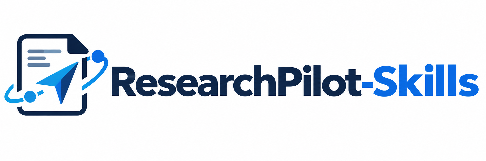

<div align="center">



[](https://github.com/LMDHQ-0420/ResearchPilot-Skills/releases)
[](https://github.com/LMDHQ-0420/ResearchPilot-Skills)
[](LICENSE)

**Asistente de investigación con IA, desde la pregunta inicial hasta el manuscrito**

[中文](README.md) | [English](README.en.md) | Español

</div>

## Novedades

- **2026/10/27**: edición en español con 16 habilidades, instaladores para Windows y macOS/Linux y desinstalación compatible con las tres ediciones.
- **2026/09/11**: habilidad independiente `/research[fig]` para generar y validar PDF, SVG y PNG a 500 dpi desde datos reales, dentro de `code/fig/`.
- **2026/07/02**: versión 2.0, con iteración de código y redacción por secciones basada en las notas públicas de Pengsida.

## Qué incluye

El flujo cubre exploración, literatura, desarrollo de la idea, experimentos, implementación, iteración y escritura. Cada etapa se carga de forma independiente.

Los experimentos buscan demostrar la eficacia de la idea. La estimación de recursos se realiza después de diseñar el plan.

El código y el diseño se mantienen sincronizados: los cambios que afecten al método o a los experimentos se reflejan primero en `idea_report.md` o `implementation.md`. El registro conserva el historial de desarrollo e iteraciones.

Las habilidades de escritura ofrecen guías y ejemplos por sección. Antes de revisar una sección se lee el manuscrito completo. La habilidad independiente de figuras puede consultar el contexto del proyecto, pero escribe solo en `code/fig/`.

## Flujo de siete etapas

| Etapa | Habilidad | Trabajo | Entregable |
|---|---|---|---|
| A: Exploración | `research[A]-exploration` | Buscar literatura, confirmar preguntas y argumentar la necesidad | `idea_report.md`, parte 1 |
| B: Desarrollo de la idea | `research[B]-idea` | Confirmar marco, procedimiento, método e introducción | `idea_report.md`, parte 2 |
| C: Diseño experimental | `research[C]-experiment` | Leer referencias y código, confirmar esquema y diseñar experimentos | `idea_report.md`, parte 3 |
| D: Implementación | `research[D]-implementation` | Guía por funciones; validar cobertura, coherencia e integridad | `implementation.md` |
| E: Programación | `research[E]-coding` | Implementar archivos, validar módulos y mantener README y registro | Código y `dev_log.md` |
| F: Iteración | `research[F]-iteration` | Diagnosticar resultados, confirmar alcance y actualizar documentos y código | Historial en `dev_log.md` |
| G: Artículo | `research[G.0]`–`research[G.7]` | Planificar, redactar cada sección y revisar el manuscrito | `docs/manuscripts/` |

Al terminar cada etapa, la IA indica el siguiente comando y espera la confirmación prevista en el flujo. Puedes consultar la [guía detallada en inglés](WORKFLOW.en.md) o la [guía en chino](WORKFLOW.md).

## Habilidades y comandos

| Habilidad | Comando | Función |
|---|---|---|
| Figuras científicas, independiente | `/research[fig]` | Crear y validar figuras en `code/fig/` |
| Entrada | `/research[START]` | Detectar la etapa y orientar la continuación |
| Exploración | `/research[A]-exploration` | Literatura, preguntas y parte 1 |
| Idea | `/research[B]-idea` | Marco técnico, procedimiento y método |
| Experimentos | `/research[C]-experiment` | Referencias y plan experimental |
| Implementación | `/research[D]-implementation` | Guía de programación y validación |
| Programación | `/research[E]-coding` | Código, registro y documentación |
| Iteración | `/research[F]-iteration` | Diagnóstico, revisión del diseño y validación |
| Planificación | `/research[G.0]-plan` | Actualizar informe, planificar figuras y elegir formato |
| Método | `/research[G.1]-method` | Redactar o revisar el método |
| Experimentos del artículo | `/research[G.2]-experiments` | Redactar o revisar experimentos |
| Resumen | `/research[G.3]-abstract` | Redactar o revisar el resumen |
| Introducción | `/research[G.4]-introduction` | Redactar o revisar la introducción |
| Trabajos relacionados | `/research[G.5]-related` | Organizar antecedentes y laguna de investigación |
| Conclusión | `/research[G.6]-conclusion` | Conclusión y referencias |
| Revisión integral | `/research[G.7]-review` | Cinco dimensiones y correspondencia entre afirmaciones y evidencia |

La descarga independiente está disponible en cualquier momento: `/research[A]-exploration download-paper descripción`.

La edición española contiene **16 habilidades**. La traducción chino-inglés `research[G.8]-translate` pertenece solo a la edición china.

## Ejemplos

```text
# Iniciar un proyecto
/research[A]-exploration Quiero mejorar la predicción del SOH de baterías; los métodos Transformer actuales no aprovechan las características temporales locales

# Comenzar con artículos
/research[A]-exploration predicción de series temporales --papers 2310.06625 "Informer 2021" paper.pdf

# Detectar la etapa actual
/research[START]

# Descargar sin iniciar el flujo
/research[A]-exploration download-paper Attention Is All You Need
/research[A]-exploration download-paper 2312.00752 --to ./my-papers

# Crear figuras independientemente
/research[fig] Dibuja los resultados reales de code/results/ como dos figuras en una fila
```

## Instalación

Clona el repositorio:

```bash
git clone https://github.com/LMDHQ-0420/ResearchPilot-Skills.git
cd ResearchPilot-Skills
```

### macOS / Linux

Elige el asistente:

```bash
bash install-es.sh            # Claude Code, predeterminado
bash install-es.sh codex      # Codex
bash install-es.sh codebuddy  # CodeBuddy, en el proyecto actual
```

### Windows

Desde PowerShell:

```powershell
.\install-es.bat            # Claude Code, predeterminado
.\install-es.bat codex      # Codex
.\install-es.bat codebuddy  # CodeBuddy, en el proyecto actual
```

En CMD puedes omitir `.\`.

### Destinos y verificación

| Asistente | macOS / Linux | Windows |
|---|---|---|
| Claude Code | `~/.claude/skills/` | `%USERPROFILE%\.claude\skills\` |
| Codex | `~/.codex/skills/` | `%USERPROFILE%\.codex\skills\` |
| CodeBuddy | `.codebuddy/skills/` del directorio actual | `.codebuddy\skills\` del directorio actual |

Comprueba que aparecen los 16 directorios de la edición española en el destino elegido. Reinicia el asistente y ejecuta `/research[START]`.

Para CodeBuddy, ejecuta desde el proyecto donde quieras instalar las habilidades. Puedes invocar el instalador español mediante su ruta absoluta: los archivos fuente se localizan junto al propio script.

### Desinstalar o cambiar de idioma

El desinstalador es común para chino, inglés y español. Indica el mismo asistente que al instalar:

```bash
bash uninstall.sh            # Claude Code
bash uninstall.sh codex
bash uninstall.sh codebuddy

# Cambiar Codex a español
bash uninstall.sh codex && bash install-es.sh codex
```

En Windows CMD:

```bat
uninstall.bat
uninstall.bat codex
uninstall.bat codebuddy

:: Cambiar Codex a espanol
uninstall.bat codex && install-es.bat codex
```

En PowerShell, ejecuta primero `.\uninstall.bat codex` y, si termina correctamente, `.\install-es.bat codex`.

Las ediciones comparten nombres de habilidad: instalar otra edición sobrescribe las de igual nombre. Para cambiar de idioma, desinstala primero; así se elimina también G.8 si estaba instalada la edición china. El desinstalador elimina únicamente los nombres de ResearchPilot de su lista y conserva las demás habilidades.

## Archivos del proyecto generado

```text
docs/
  idea_report.md          # Motivación, RQ, método y diseño experimental
  implementation.md       # Guía de programación por funciones
  dev_log.md              # Registro de desarrollo e iteraciones
  user_requirements.md    # Restricciones recopiladas en conversación
  papers/                 # PDF o resúmenes TXT
  manuscripts/
    paper.md / paper.tex  # Manuscrito actual
    paper_{fecha}.*       # Copias previas a la edición
    examples/             # Ejemplos de escritura
    templates/            # Plantillas LaTeX
code/
  fig/                    # Scripts, especificaciones, PDF/SVG/PNG y controles
  src/
    models/
      baseline/
    data/
    train.py
    evaluate.py
    utils/
  scripts/
  configs/
  data/
  results/
  logs/
  README.md
  requirements.txt
```

## Preguntas frecuentes

**¿No se activa una habilidad?** Comprueba los directorios del asistente elegido, repite la instalación si faltan y reinicia el asistente.

**¿Falla una descarga?** Se intenta arXiv y después OpenReview. Si no hay PDF, se guarda el resumen cuando está disponible o se marca la cita pendiente. También puedes colocar el PDF en `docs/papers/` con el título completo.

**¿Cambió la arquitectura?** Usa `/research[F]-iteration`: diagnóstico, confirmación del alcance, documentos y después código.

**¿Puedo saltar etapas?** Las habilidades se pueden invocar independientemente, pero necesitan sus documentos previos. Usa `/research[START]` para detectar el estado.

**¿Puedo escribir en otro idioma?** El español es el idioma predeterminado de esta edición. Puedes indicar otro idioma; los requisitos confirmados del usuario prevalecen.

## Agradecimientos

Las guías y ejemplos de redacción G.1–G.7 se basan principalmente en:

- **Pengsida**: [notas públicas](https://pengsida.notion.site/c1a22465a0fa4b15a12985223916048e) y [learning_research](https://github.com/pengsida/learning_research).
- [Master-cai/Research-Paper-Writing-Skills](https://github.com/Master-cai/Research-Paper-Writing-Skills): habilidades de escritura para ML/CV/NLP.
- [Yuan1z0825/nature-skills](https://github.com/Yuan1z0825/nature-skills): escritura y figuras científicas.
- [Imbad0202/academic-research-skills](https://github.com/Imbad0202/academic-research-skills): flujo de investigación y ejemplos.

## Licencia

MIT. Consulta [LICENSE](LICENSE).
